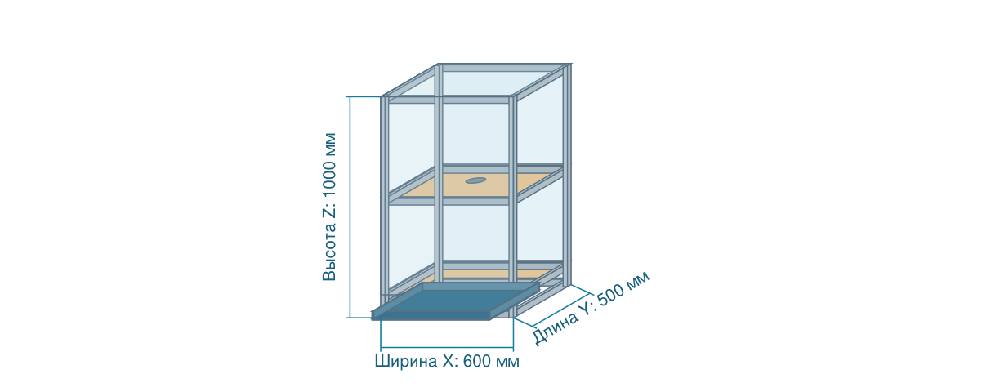
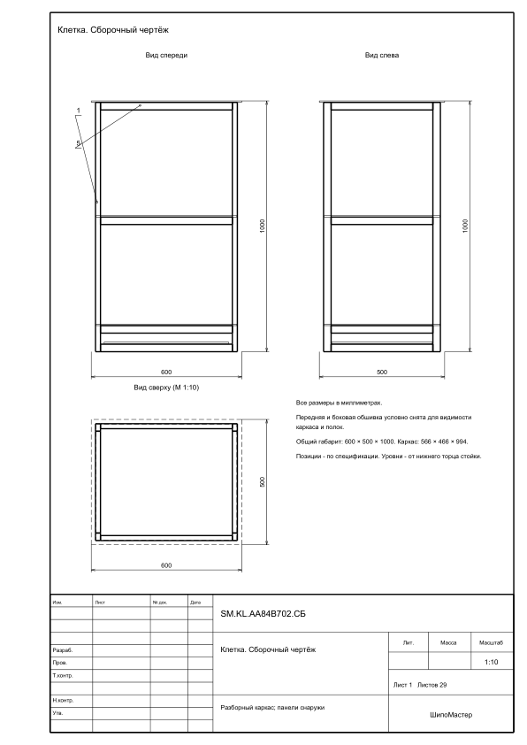
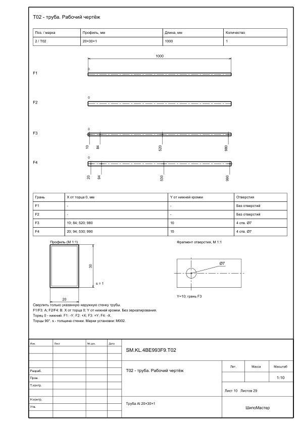

# ШипоМастер Aspire

Гаджет для **Vectric Aspire 12.5 под Windows x64**: шипованные ящики, перегородки, гибкие прорези, изогнутые крышки и клетка с разборным алюминиевым каркасом.

**Текущая версия: 1.5.7.** Проверено в Aspire **12.504**. Совместимость с другими версиями Aspire и с VCarve не проверялась.

## Скачать и установить

1. Откройте [последний релиз](https://github.com/i-strannik-i/ShipoMaster-Aspire/releases/latest).
2. В разделе **Assets** скачайте **`ShipoMaster_Aspire_1.5.7.vgadget`**. Архивы **Source code** предназначены для разработчиков.
3. В Aspire выберите **Gadgets → Install New Gadget…** и укажите скачанный `.vgadget`.
4. Создайте или откройте проект и задайте толщину материала в **Job Setup → Thickness (Z)**.
5. Запустите **Gadgets → ShipoMaster Aspire → ShipoMaster Aspire**. Если пункт не появился, закройте и снова откройте Aspire.

Для готового гаджета отдельно устанавливать Python и библиотеки **не требуется**: движок Windows x64 входит в пакет. При обновлении закройте диалог гаджета, установите новый `.vgadget` и запустите его заново.

Подробности и ручная установка: [инструкция](docs/INSTALL_RU.md). Описание настроек: [README_RU.txt](README_RU.txt).

## Возможности

- Девять режимов ящиков: обычные, с перегородками, дном/крышкой в пазы, гибкой обёрткой и изогнутой крышей.
- Два крепления изогнутой крыши: закрытые пазы с отступом или накладная крыша со съёмными фиксаторами.
- Выбор рисунка прорезей с картинками; несквозные пропилы с расчётом глубины и остаточного слоя.
- Проверка прохода фрезы, разгрузки углов и настраиваемые обжимные выступы для плотной посадки.
- Автоматическое увеличение активного листа под раскладку без масштабирования существующих объектов.
- Вкладка **«Клетка»**: каркас внутри, панели снаружи, полки, перегородки, проходы и выдвижной лоток. Каркас из прямоугольной трубы, собственные угловые накладки, крепление М5 в заклёпочные гайки или саморезами.
- Единый PDF клетки: сборка, разнесённые панели, виды, узлы, ведомости, четыре грани типов труб и листовые детали. По умолчанию **A4**, доступны другие форматы и свои размеры страницы.



Вводимые размеры и размерные линии на картинке относятся к полному наружному габариту с обшивкой. Каркас рассчитывается автоматически и показан отдельно. Схема меняется при вводе размеров.

[Пример сборочного PDF — 600 × 500 × 1000 мм, 29 страниц A4](examples/cage_assembly_A4.pdf).

## Начало работы

Все размеры в диалоге задаются в **миллиметрах**, в том числе при дюймовом проекте. Допускаются точка и запятая.

Для ящика выберите режим, размеры, фрезу и параметры соединений; затем нажмите **«Создать в Aspire»**. Для клетки используйте отдельную вкладку и кнопку **«Создать детали клетки в Aspire»**. Гаджет добавляет векторы на слои; после закрытия диалога они доступны для редактирования.

Толщина стенок берётся из проекта. Во вкладке клетки толщина стенок и дна/бортов лотка также берётся из текущего проекта; толщина полок и перегородок задаётся отдельно. Дверей в текущем варианте клетки нет.

Для чертежей клетки выберите папку, формат страницы и нажмите **«Сохранить единый PDF»**. В выбранной папке создаётся новая подпапка. По умолчанию включено **«Только PDF»**; если его снять, дополнительно сохраняются DXF, CSV и JSON. Экспорт старых режимов ящиков временно отключён.

## Ограничения текущей версии

- Гаджет создаёт геометрию; траектории, режимы резания и крепление заготовок задаются в Aspire отдельно.
- На рабочих листах указан масштаб изображения. Печатайте **100% без подгонки**, чтобы его сохранить; размерные значения всегда натуральные, в миллиметрах. Уменьшенные копии A4 помечены отдельно.
- Для каркаса используется рисунок отверстий собственных накладок. Параметры заклёпочных гаек и саморезов нужно сверить с выбранной фурнитурой; отверстия под направляющие и крепления панелей без размеров этой фурнитуры не назначаются.
- Геометрическая проверка не заменяет расчёт прочности. Остаточный слой гибких пропилов и натяг соединений проверяются на образце из фактического материала.

## Проверки и сборка из исходников

Среда сборки: **Python 3.11 x64**, Windows; **Node.js** нужен для тестов предпросмотра.

```powershell
python -m venv .venv
.venv\Scripts\python -m pip install -r requirements.txt
.venv\Scripts\python -m unittest discover -p "test_*.py"
node test_preview.js
node test_cage_ui.js
node test_dialog_ui.js
.venv\Scripts\python -m PyInstaller --noconfirm --onefile --noconsole --name ShipoMasterEngine --distpath bin --workpath build geometry_worker.py
.venv\Scripts\python package_gadget.py
```

Готовый файл появится в корне проекта: `ShipoMaster_Aspire_1.5.7.vgadget`. Флаг `--install` у `package_gadget.py` дополнительно копирует пакет в общую папку гаджетов Aspire 12.5. Для смены версии используется `bump_version.py`.

Результаты проверок и сведения о проверках в Aspire: [VERIFICATION_RU.txt](VERIFICATION_RU.txt).

## Происхождение и сторонние компоненты

Часть геометрии перенесена из предоставленного макроса **ШипоЯщик / ShipoYashchik V2.01 (май 2015)**; авторы оригинала: **Ulibka, Superbizon, alleks67**. Перенос описан в `translate_source.py`; этот инструмент не нужен для сборки и использует внешние исходники первоначального макроса.

Готовый пакет содержит Python и сторонние библиотеки. Их лицензионные уведомления находятся в папке **LICENSES** внутри `.vgadget`. Vectric Aspire в поставку не входит.

Сообщения об ошибках: [Issues](https://github.com/i-strannik-i/ShipoMaster-Aspire/issues). Приложите версию Aspire, режим, входные размеры и скриншот результата.


Обновления: при открытии About автоматически проверяется новая версия. Вход и регистрация на GitHub не требуются. Кнопка «Обновить» скачивает пакет, проверяет SHA-256 и открывает папку с ним. Завершите установку в Aspire через Gadgets → Install New Gadget… Обратная связь: strannik.rvs@yandex.ru.

Подписи раскладки: отдельный слой INFO, номера на деталях и таблица названий с габаритами по внешнему контуру (Ш × Д × Т, мм). Размер текста подбирается для A4 с учётом текущего листа. При печати включите INFO и масштабирование под страницу. Слой INFO не фрезеровать; он не входит в автоматическое выделение контуров обработки. Для таблицы при необходимости увеличивается лист. На мелких деталях номера меньше; полные названия и размеры остаются в таблице.


Оформление и ограничения чертежей: [правила и источники](docs/DRAWING_RULES_RU.md).

Примеры новых рабочих листов:





Для дополнительной проверки отрисовки PDF в тестах можно установить `pip install pymupdf`; для запуска гаджета он не требуется.


Размеры клетки X/Y/Z - ПОЛНЫЕ НАРУЖНЫЕ, включая обшивку. Каркас: X/Y = общий размер минус дважды (боковой отступ + толщина стенки); Z = общая высота минус толщина верхней панели. Например, при обшивке 6 мм и боковом отступе 11 мм общий габарит 600×500×1000 даёт каркас 566×466×994. Подписи, модель и PDF используют одну трактовку.

Для ящиков добавлена кнопка «Сборочный чертёж» рядом с «Создать в Aspire»: добавляет только схему сборки на INFO на том же листе рядом с раскладкой, без повторного создания деталей. Существующие объекты не перемещаются; при необходимости лист увеличивается. После изменения параметров существующей раскладки сначала пересоздайте детали. На INFO чертёж не предназначен для фрезерования.

## Назначение слоёв (Aspire)

- out: наружные контуры, 2D Profile — Outside / Right.
- In: внутренние вырезы и пазы, 2D Profile — Inside / Left.
- On: сквозные открытые прорези, 2D Profile — On.
- DRILL: отверстия под сверление.
- INFO: номера, таблицы и сборочные схемы; НЕ фрезеровать.

Для деталей иной толщины, чем материал проекта, добавляется `_T_<толщина>mm`.
Несквозные пропилы: `On_KERF_INSIDE_DEPTH_<глубина>mm_REMAIN_<остаток>mm`.
Глубина задана от внутренней стороны; снаружи оставляется указанный остаток.
Траектории и глубины назначаются в Aspire вручную: имя слоя их не задаёт.
Повторное создание добавляет векторы на те же слои; старые векторы сохраняются.
Ранее созданные слои не переименовываются. Разделение действует для новых деталей.

Режим «Клетка (эксперимент)» — экспериментальный: расчёты и конструкция находятся в разработке.
